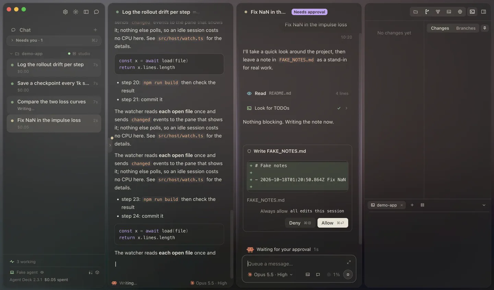
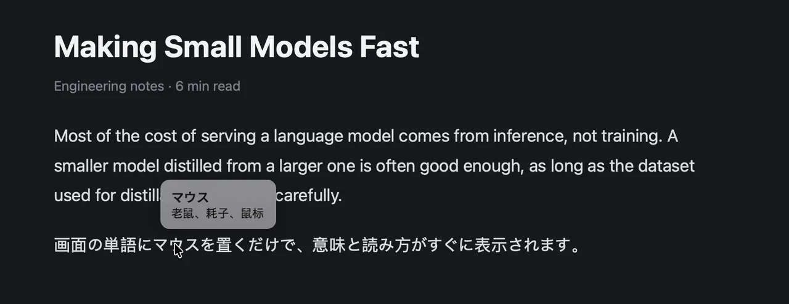
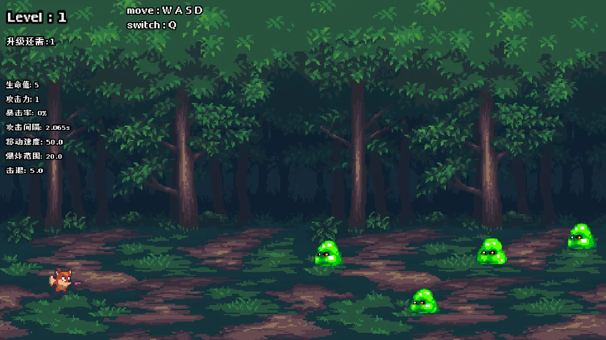
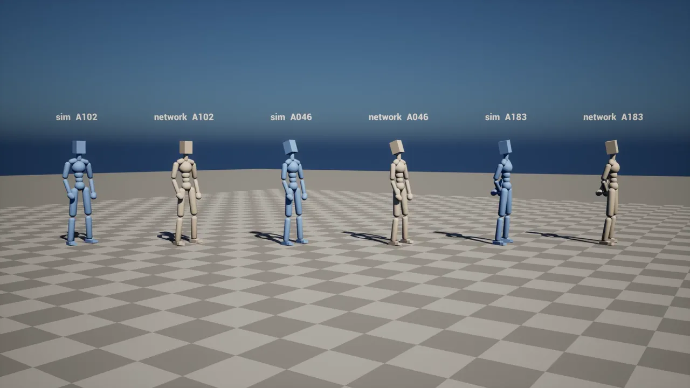

# Hi, I'm iren 👋

I'm an AI developer. My main project is Agent Deck, a workspace for running many Claude Code agents at once. I also put language models to work in small, useful apps, like a Chinese input method that runs a language model on-device.

🌐 **[iren.page](https://iren.page)**: demos, recordings, and an AI version of me you can chat with.

---

## Main project

### Agent Deck *(private, demo on [iren.page](https://iren.page))*
A macOS development environment for running many Claude Code agents in parallel. A planning agent splits the work, each agent builds on its own branch, and changes merge once the tests pass. Approvals are tiered by risk, and a plan library keeps tasks, decisions and hand-overs.

---

## Public projects

### [LLM IME](https://github.com/yizilian-iren/llm-ime)
A Chinese input method for macOS: type only the first letter of each syllable (`wjdzgxfh`) and a small fine-tuned language model, running locally, suggests the whole sentence (我觉得这个想法很好) from the text before the cursor. Nothing typed leaves the Mac. I use it every day.

### [HoverDict](https://github.com/yizilian-iren/HoverDict)
A macOS menu-bar dictionary: hover over an English or Japanese word to see its Chinese meaning and hear it read aloud. Words are read by screen OCR, so it also works in web pages and Electron apps.

### [爆杀小怪兽 (mygame1)](https://github.com/yizilian-iren/mygame1)
A 2D pixel-art survival action game made in Godot 4. **[Play it in the browser](https://yizilian-iren.github.io/mygame1/)**.

---

## Other private projects

These repositories are private. Recordings and write-ups are on [iren.page](https://iren.page).

### SCIR *(research project, unpublished)*
Hit-reaction generation for game characters: a lightweight model produces 2 seconds of full-body motion from the pose and the hit in one pass, demonstrated on a character in Unreal Engine.

### AI Me *(private, live on the site)*
A chat AI on iren.page that appears as my pixel figure and answers questions about my projects from public information only. Built on the Claude API and Cloudflare Workers, with streamed replies and usage limits.

### Personal website, [iren.page](https://iren.page)
Astro site with the project demos above, in English, Japanese and Chinese.

---

**Tools I use:** Swift, Python, TypeScript, Godot, MLX, Claude Code
